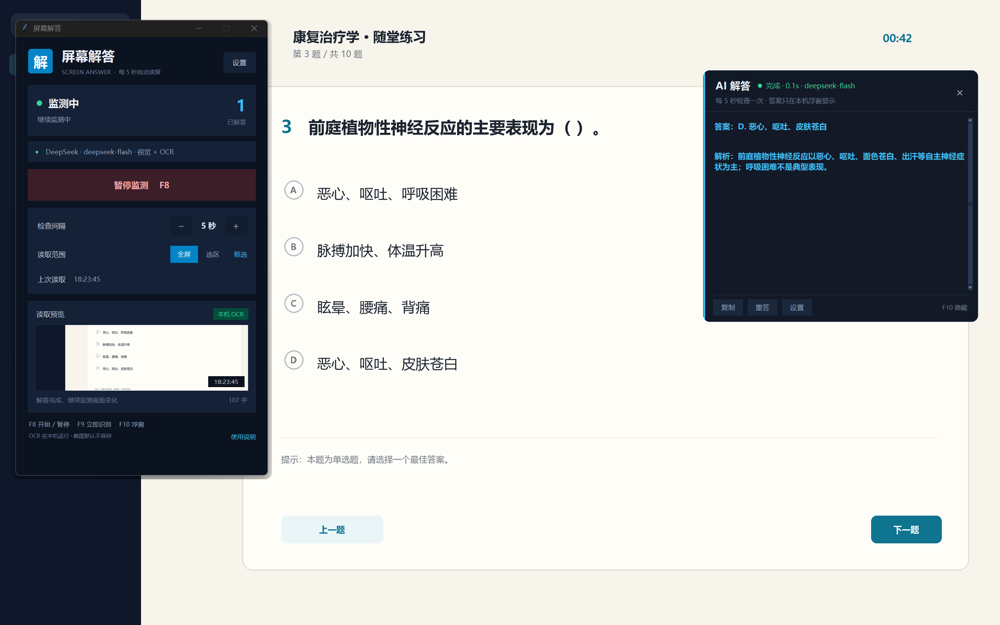

# 屏幕解答 · Screen Answer

一个 Windows 桌面小工具：每隔几秒读取一次屏幕，识别题目，自动把答案和解析显示在一个置顶浮窗里。



*界面演示：本地 mock 模型返回的示例答案。*

> **当前版本：1.0.6**
>
> - 新增**识图模式**：只做本地 OCR，自动复制题目文字，不需要 API Key，也不请求模型。
> - 截图不再闪烁：不再临时隐藏窗口，而是在截图内遮掉自己的浮窗/主窗口。
> - 框选区域现在会原样送去 OCR，不再在区域内部二次自动裁剪；识图模式第一次会建议框选。
> - 修复换题后画面变化较小、被误判为“没变化”而不再截图的问题。
> - 修复热键被其他软件占用时后台报错的问题。
> - 修复单实例误判、短屏幕下窗口底部被裁掉的问题。

---

## 功能

- 默认每 **5 秒**检查一次屏幕，可调 2–120 秒。
- 本地 OCR（Windows 自带中文识别），不依赖云端 OCR。
- **识图模式**：只识别并复制题目文字，不调用 API；适合把题目粘到别处。
- API 模式：只在画面/题目变化时请求模型，静止画面不会反复消耗额度。
- 自动定位题目区域，也可以手动「框选」题干和选项。
- 答案/文字以置顶浮窗显示，不抢键盘焦点；`F8` 开始/暂停，`F9` 立即识别，`F10` 显示/隐藏浮窗。
- 支持任意 OpenAI 兼容接口：DeepSeek、通义千问、智谱 GLM、Kimi、硅基流动、OpenAI、Ollama 本地。
- API Key 用 Windows DPAPI 加密保存。
- 不会自动点击选项、不会自动提交。

> 请用于学习自查和复习。在线考试、测验、竞赛请遵守课程和平台规则，不要用本工具代答。

---

## 系统要求

- Windows 10 2004+ 或 Windows 11。
- 安装中文 OCR 语言包（中文 Windows 通常已自带）：
  设置 → 时间和语言 → 语言和区域 → 中文 → 语言选项 → 光学字符识别。
- 使用 API 模式需要一个模型服务商的账号；本地 Ollama 不需要 API Key。
- 源码运行需要 Python 3.12（推荐）。

---

## 快速开始

### 方式一：下载打包版（推荐）

1. 到 [Releases](../../releases/latest) 下载 `ScreenAnswer-win64.zip`。
2. 解压到一个**有写入权限**的目录，例如桌面或文档，不要直接放在 `Program Files`。
3. 双击 `ScreenAnswer.exe`。
4. 点窗口上方的「还没配置模型 API」横条，或右上角「设置」。
5. 选择服务商，填入 API Key，点「测试连接」→「保存并关闭」。
6. 点「开始监测」，或按 `F8`。
7. 第一次建议点「框选」，框住题目和选项；也可以直接用全屏。

答案会出现在屏幕右侧的浮窗里。拖动浮窗标题栏可以换位置。

> Windows SmartScreen 可能提示“未知发布者”，因为本地构建的 exe 没有代码签名。点「更多信息 → 仍要运行」即可。

### 方式二：从源码运行

```bat
git clone https://github.com/<your-name>/screen-answer.git
cd screen-answer
install.bat
run.bat
```

调试（有控制台和详细日志）：

```bat
run_debug.bat
```

`install.bat` 会创建 `.venv` 并安装依赖。它不会修改系统 Python。

---

## 识图模式（不调用 API）

只想把题目文字复制出来、不想花 token 时用这个模式。

1. 打开「设置」。
2. 勾选 **识图模式（只 OCR 并复制文字，不调用 API）**。
3. 保存，点「开始监测」。
4. 第一次会建议你框选题目区域；框选后只识别这一块，桌面图标、浏览器地址栏等干扰会少很多。
5. 每次识别到新文字，程序会：
   - 自动复制到剪贴板；
   - 在浮窗里显示识别结果；
   - 主窗口计数显示「已识别」。
6. 点浮窗的「复制文字」可以再复制一次。

这个模式：

- 不需要 API Key，也不会发送任何网络请求；
- 仍然使用 Windows 本地 OCR；
- 仍然只在文字变化时处理，静态画面不会重复复制；
- 适合把题目粘到搜索、笔记或其他工具里。

> 截图时程序不会再把窗口闪一下；它是在截下来的图片里把浮窗/主窗口区域遮掉。副作用是：**被主窗口或浮窗挡住的那部分题目不会被识别**，所以建议框选题目区域，并把浮窗拖到不挡题目的位置。主窗口可以点「开始监测后自动最小化」。

---

## 配置 API

### DeepSeek V4.1 Flash（默认预设）

| 设置项 | 值 |
|---|---|
| 服务商 | `DeepSeek` |
| API 地址 | `https://api.deepseek.com` |
| 模型名称 | `deepseek-flash` |
| 视觉模型 | 打开（V4.1 Flash 原生支持图片） |
| API Key | [DeepSeek 开放平台](https://platform.deepseek.com/api_keys) |

注意：

- Key 免费申请，但账户需要有可用余额；没有余额时请求会返回 `402`。
- 模型名不是 `DeepSeek-V4.1-Flash Max`，也不是旧的 `deepseek-chat`；API 只认 `deepseek-flash`。
- 地址末尾不要手写 `/chat/completions`，程序会自动补。
- 本程序调用 DeepSeek 时会传 `thinking: disabled`，优先快速给答案，避免思考 token 占用回答长度。

### 其他服务商

| 服务商 | API 地址 | 默认模型 | 看图 |
|---|---|---|---|
| DeepSeek | `https://api.deepseek.com` | `deepseek-flash` | 是 |
| 通义千问 · 百炼 | `https://dashscope.aliyuncs.com/compatible-mode/v1` | `qwen-vl-max-latest` | 是 |
| 智谱 GLM | `https://open.bigmodel.cn/api/paas/v4` | `glm-4v-flash` | 是 |
| Kimi | `https://api.moonshot.cn/v1` | `moonshot-v1-8k-vision-preview` | 是 |
| 硅基流动 | `https://api.siliconflow.cn/v1` | `Qwen/Qwen2.5-VL-7B-Instruct` | 是 |
| OpenAI | `https://api.openai.com/v1` | `gpt-4o-mini` | 是 |
| Ollama 本地 | `http://127.0.0.1:11434/v1` | `qwen2.5vl:7b` | 是 |

模型名称和价格会变化，以服务商控制台为准。

### 不想花 token：Ollama 本地

这是目前唯一的“零 API 费用”全自动方案：

1. 安装 [Ollama](https://ollama.com/download)。
2. 运行 `ollama pull qwen2.5vl:7b`。
3. 在设置里选「Ollama 本地」，API Key 留空，保存。
4. 确保 Ollama 正在运行，再点开始监测。

速度取决于你的显卡/内存；7B 视觉模型在普通笔记本上会比较慢，但不需要 API Key。

---

## 怎么用

1. 设置好模型（或开启识图模式）。
2. 建议点「框选题目」，框住题干和选项；全屏也可以，但 OCR 更容易受桌面图标干扰。
3. 点「开始监测」或按 `F8`。
4. 翻到下一题时，程序会检测画面变化并重新识别；同一题不动不会重复请求。
5. 答案在浮窗中显示，可点「复制」。
6. 如果某次没触发，按 `F9` 立即识别当前屏幕。

框选区域会同时用于 API 模式和识图模式，并且**只读取你框住的那一块**。截图时程序不会闪窗，而是把浮窗/主窗口在截图里遮掉；所以请把浮窗拖到不挡题目的位置。被挡住的部分无法识别。

### 热键

| 热键 | 功能 |
|---|---|
| `F8` | 开始 / 暂停监测 |
| `F9` | 立即识别当前屏幕 |
| `F10` | 显示 / 隐藏答案浮窗 |

如果热键被其他软件占用，程序会在右下角提示，界面按钮仍然可用。

---

## 工作原理

1. 每隔 N 秒截一张屏幕（默认只截你选的范围）。
2. 截图时不再闪窗；程序直接在截图里把浮窗/主窗口区域用页面背景色遮掉，避免把自己的旧答案读进去。
3. 用 Windows 自带的 `Windows.Media.Ocr` 在本机识别文字。
4. 自动寻找题干/选项区域，把桌面图标、浏览器地址栏等噪声裁掉。
5. 画面和题目文字都没变化 → 跳过，不请求模型。
6. 有新题目 → 调用你配置的模型，流式显示答案。
7. 只显示答案，**不会自动点击选项、不会自动提交**。

---

## 隐私

- OCR 完全在本机完成。
- 默认不保存截图；`config.json` 里的 `behavior.save_screenshots` 目前不启用落盘。
- 视觉模式下，只有题目区域的截图会发送给你配置的模型服务；文本模式下只发送 OCR 文字。
- API Key 用当前 Windows 用户的 DPAPI 加密，`config.json` 里不是明文。
- 日志 `logs/app.log` 不记录题目文字和 Key。
- 如果屏幕上有密码、聊天记录等敏感内容，建议用「框选」只框题目区域。

### 配置和日志在哪

- 打包版：默认在 `ScreenAnswer.exe` 同目录的 `config.json` 和 `logs/`。
- 如果 exe 所在目录不可写（例如 `Program Files`），会自动放到：
  `%LOCALAPPDATA%\ScreenAnswer\config.json`。
- 源码版：项目根目录的 `config.json` 和 `logs/`。
- `config.json` 已被 `.gitignore` 排除，**不要提交到 GitHub**。

---

## 常见问题

**启动后没反应 / 提示没有 API Key**
先配置模型。没有 Key 时程序仍会 OCR，但不会生成答案；也可以开启「识图模式」只复制文字，或改用 Ollama。

**401 / 403**
Key 错了、过期了，或没有该模型权限。重新复制 Key，确认模型名可用。

**402**
账户余额不足。到服务商开放平台充值。

**404**
API 地址或模型名不对。DeepSeek 地址是 `https://api.deepseek.com`；通义千问是 `.../compatible-mode/v1`。

**429**
请求太频繁或额度不足。把检查间隔调大，或稍后再试。

**识别不到文字**
- 确认 Windows 已安装中文 OCR 语言包。
- 题目字体太小？用「框选」只框题目，程序会自动放大 OCR。
- 受 DRM 保护的窗口、部分游戏/视频画面可能截不到。

**翻到下一题后没有反应**
1. 先按 `F9` 立即识别，确认程序还能读屏。
2. 确认浮窗没有完全盖住题目变化区域；被盖住的部分不参与变化检测。
3. 把 `logs/app.log` 发到 issue（删除个人信息和 Key）。
4. 当前版本已修复“变化太小被跳过”的问题；如果仍出现，请附上日志。

**浮窗挡住题目**
拖动浮窗标题栏到题目区域之外。程序不会闪窗，但会把你窗口占用的区域从截图里遮掉；被挡住的部分无法识别。

**热键冲突**
关闭占用 F8/F9/F10 的软件；或者直接用界面按钮。

**窗口显示不全**
1.0.4 会按屏幕高度自动缩放；如果仍然显示不全，请附上屏幕分辨率和缩放比例。

---

## 开发

```bat
install.bat
run.bat
run_tests.bat
```

手动运行测试：

```bat
.venv\Scripts\python.exe -m unittest discover -s tests -v
```

代码检查：

```bat
.venv\Scripts\python.exe -m pyflakes app.py screen_answer
```

### 打包 exe

```bat
build.bat
```

输出：

- `dist\ScreenAnswer\ScreenAnswer.exe`
- `ScreenAnswer-win64.zip`

打包使用 PyInstaller；`build.bat` 会自动安装 PyInstaller 并收集 `winrt` 依赖。

### 目录结构

```
screen_answer/
  app.py                    入口
  screen_answer/            源码
    main_ui.py              主窗口
    overlay.py              置顶答案浮窗
    settings_dialog.py      模型设置
    region_selector.py      框选题目区域
    monitor.py              定时截图 → OCR → 模型
    ocr_engine.py           Windows OCR
    capture.py              mss 截图 / 变化检测
    llm.py                  OpenAI 兼容流式客户端
    config.py               配置 / 预设 / 日志
    secret.py               DPAPI 加密
    winutil.py              置顶 / 热键 / DPI
  assets/                   图标
  docs/                     截图
  tests/                    单元测试
  install.bat               创建 .venv 并安装依赖
  run.bat                   启动
  run_debug.bat             调试启动
  run_tests.bat             运行测试
  build.bat                 打包 exe
  .github/                  CI 和 issue 模板
```

---

## 发布到 GitHub

第一次发布请照着 [GITHUB_UPLOAD.md](GITHUB_UPLOAD.md) 做：里面有 GitHub Desktop 和命令行两种方式，以及“不要上传 config.json / Key”的检查步骤。

---

## License

[MIT](LICENSE)

## 免责声明

本工具只做屏幕 OCR 和答案展示，不保证模型答案正确，也不会自动操作考试页面。使用前请确认符合你所在课程、学校和平台的规定；因使用本工具产生的后果由使用者自行承担。
